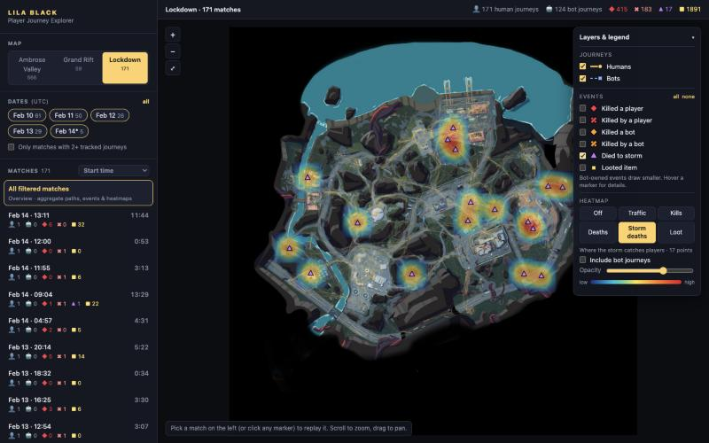
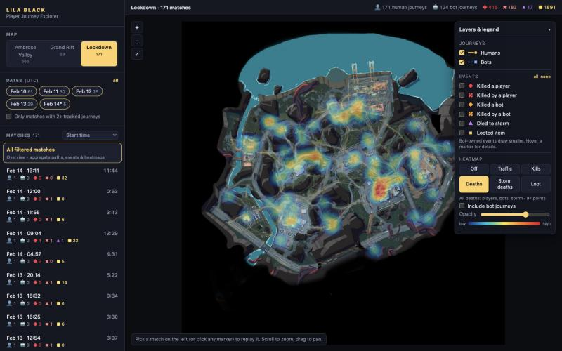
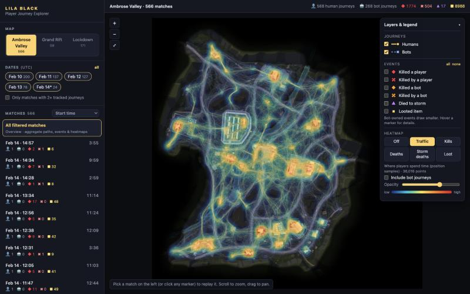

# Three things the tool shows about LILA BLACK

All numbers come from the cleaned data the tool uses (798 human journeys, 796 matches, Feb 10–14 2026). `pipeline/insights.py` reproduces them. To see each pattern in the tool, follow the "In the tool" steps.

---

## 1. The storm doesn't catch players who are out of position. It catches players who stayed too long, and Lockdown is 3× worse.

**What caught my eye.** With the *Storm deaths* heatmap and markers on, storm deaths are scattered across the whole map rather than lined up along one edge, which is what a wall closing in from one side would produce. On the timeline, every storm death sits in the last few minutes of its match.

**Evidence**

| | Ambrose Valley | Grand Rift | Lockdown |
|---|---|---|---|
| Human journeys ending in storm death | 17 / 568 (**3.0%**) | 5 / 59 (8.5%) | 17 / 171 (**9.9%**) |
| Earliest / median storm death | 11:09 / 12:10 | 11:23 / 11:56 | 10:55 / 12:41 |
| Median journey length: storm victims vs. survivors | 12:09 vs 8:18 | 11:54 vs 7:17 | 12:44 vs 8:38 |
| Median loot pickups: storm victims vs. survivors | 19 vs 21 | 21 vs 18 | 16 vs 14.5 |

- No storm death happens before 10:55, in any match on any map.
- Storm victims had looted as much as players who survived. They weren't struggling players; they were successful raids that ran out of time.
- Lockdown is the smallest map, yet its storm death rate is 3.3× Ambrose Valley's. (Grand Rift's n=5 is too small to read.)

**Actionable?** Yes.
- Lockdown first: check extraction count and placement against storm timing, and test either one more late-game extraction or a slower final storm phase.
- Make the deadline easier to read: a stronger warning at ~10:30 (just before the earliest storm death), and extraction markers that are visible from the loot hotspots.
- **Metrics to watch:** storm death rate per map (target: Lockdown down to ~3%, Ambrose Valley's level), extraction rate, average loot extracted per raid, and share of raids that end after 11:00.

**Why a level designer should care.** Dying with a full bag is the most frustrating way to lose in an extraction shooter, and it hits engaged players hardest. Since position isn't the cause, the fix is in extraction layout and pacing, which is level design's domain.

*In the tool:* Lockdown → Heatmap: Storm deaths → Events: none, then tick "Died to storm". Open any match with ▲ in the list and press ⏭ to jump to the storm death.

---

## 2. Bots, not other players, decide raids, and they kill in a few specific pockets.

**What caught my eye.** Turning on "Killed by a player" leaves the map almost empty. Turning on "Killed by a bot" fills it. With *Deaths* as the heatmap (bots excluded), Lockdown shows one bright hotspot east of centre.

**Evidence**
- In 5 days there were **3 PvP deaths among 798 human journeys (0.4%)**, while **401 (50%) ended in death to a bot**. Each human's file records how *that* human died, so this holds even though most matches have only one human file.
- Bot deaths cluster in a few spots. I compared each 64×64 px zone's share of deaths-to-bots with its share of human time (a "lethality" ratio):

| Map | Zone (minimap px) | Share of deaths to bots | Share of human time | Lethality |
|---|---|---|---|---|
| Lockdown | east of centre (576–640, 512–576) | **15%** (12 / 80) | 3.6% | **4.2×** |
| Ambrose Valley | west of centre (256–384, 512–576), 2 zones | 15% (46 / 297) | 5.2% | 2.6–3.5× |
| Grand Rift | central N–S corridor through Mine Pit (x 448–512) | 54% in 5 zones (n=24, small) | — | 3.0–4.3× |

- Early deaths: 13% (Ambrose Valley) and 19% (Lockdown) of bot deaths happen in the **first two minutes**. The median first fight comes at ~2:10.

**Actionable?** Yes.
- Review bot spawns, patrol routes, sightlines and cover in these zones. A 4× lethality pocket usually means an exposed approach or a bot spawn sitting on a natural path.
- Treat bot placement as part of level design: bots are effectively the map's PvE "fights", so they shape routing as much as geometry does.
- **Metrics:** death-to-bot rate per map, lethality per zone (target < 2×), share of deaths in the first 2 minutes, and time to first combat.

**Why a level designer should care.** Current flow and frustration come from where bots are and what the terrain gives players against them. If PvP is meant to be the core of the game, the map isn't producing it yet, so either matchmaking or the layout has to push humans together.

*In the tool:* Lockdown → Heatmap: Deaths → untick "Include bot journeys" → Events: none.

---

## 3. Loot decides where players go, and Ambrose Valley's outer ring is dead space.

**What caught my eye.** Ambrose Valley's *Traffic* heatmap looks almost identical to its *Loot* heatmap: bright building clusters with a dark rim around the edge of the playable area.

**Evidence**
- Per 64 px zone, human time and loot pickups are strongly correlated: Spearman ρ = **0.85** on Ambrose Valley, 0.87 on Lockdown, 0.66 on Grand Rift.
- On Ambrose Valley, the **top 10% of zones (13 of 130) hold 36% of human time and 57% of all loot pickups**.
- **25 of 130 reachable zones (19%) get ≤ 0.1% of human time** and only 0.2% of loot. They form the perimeter: the southern strip (y ≈ 896–960, right below the map's hottest loot belt at y ≈ 768–896), the east edge and the northern band.
- (Caveat: causality runs both ways. Players loot where they are, and they go where loot is.)

**Actionable?** Yes.
- Either make the dead ring worth visiting (loot caches, an extraction point or an objective at the southern and eastern edges) or tighten the playable boundary there.
- Spread high-value loot beyond the 13 hot zones so routes diverge, which lowers how predictable spawn-to-loot paths are.
- **Metrics:** map coverage (% of reachable zones above 0.1% of time), traffic concentration (top-10% share, now 36%), loot per minute, and time to first contact.

**Why a level designer should care.** About a fifth of Ambrose Valley's playable footprint is built, lit and art-passed, and almost nobody goes there. That space also lengthens rotations without adding decisions. Loot placement is the cheapest lever available to redistribute players.

*In the tool:* Ambrose Valley → Heatmap: Traffic, untick "Include bot journeys", then compare with Heatmap: Loot.
