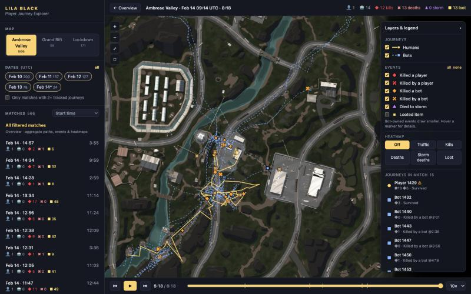

# LILA BLACK — Player Journey Explorer

A browser tool for level designers that turns five days of LILA BLACK telemetry into something you can look at: player paths on the real minimap, kills, deaths, loot and storm deaths, match replay, and heatmaps.

**Live tool:** https://lila-player-journey-manish.vercel.app

**Video walkthrough (2 min):** [docs/walkthrough.mp4](docs/walkthrough.mp4)

| Doc | What's in it |
|---|---|
| [ARCHITECTURE.md](ARCHITECTURE.md) | Stack, data flow, coordinate mapping, assumptions, trade-offs |
| [INSIGHTS.md](INSIGHTS.md) | Three findings about the game, with evidence and actions |



## What it does

- **Maps:** Ambrose Valley, Grand Rift and Lockdown, with world coordinates mapped onto each minimap and pan/zoom.
- **Humans vs bots:** humans are solid warm-coloured lines with round heads. Bots are dashed blue lines with square heads. Bot-owned event markers draw smaller.
- **Event markers:** shape gives the category and colour gives who was involved.
  ◆ kill · ✖ death · ▲ storm death · ■ loot (red = vs a human, orange = vs a bot).
  Hover any marker for who, when, and how that journey ended.
- **Filters:** map, date (multi-select), "only matches with 2+ tracked journeys", and a sortable match list (longest, most kills, deaths, storm deaths, loot, bots).
- **Overview mode** (default): every filtered match drawn at once, so you can read patterns across the whole map. Click any marker to open its match.
- **Match playback:** play/pause, 1–60× speed, a scrubber with fight and death ticks, and jumps to the previous/next fight. Player heads are interpolated between the 5 s position samples. Click a journey in the side panel to isolate it.
- **Heatmaps:** traffic (time spent), kills, deaths, storm deaths and loot. They can include or exclude bots, and during a match they can show either all filtered matches (for context) or just that match.
- **Shareable views:** the URL keeps map, match and heatmap (`#map=Lockdown&match=…&heat=deaths`).
- **Keyboard:** `Space` play/pause · `←`/`→` ±5 s · `Esc` back to overview · double-click the map to re-fit.

## Tech stack

| Part | Tech |
|---|---|
| Data pipeline | Python 3.11+, pyarrow, pandas, Pillow |
| Frontend | Vite 5, React 18, TypeScript, Canvas 2D (no other runtime dependencies) |
| Hosting | Vercel, as a static site ([web/vercel.json](web/vercel.json)) |

## Run locally

The processed data is committed in `web/public/`, so the frontend runs without Python or the raw files.

```bash
cd web
npm ci
npm run dev        # http://localhost:5173
```

Production build: `npm run build` (output in `web/dist`). Type-check: `npm run typecheck`.

**Environment variables:** none. The app is fully static.

## Rebuilding the data

The raw telemetry (`player_data.zip`) is not committed. To regenerate `web/public/data` and `web/public/minimaps`:

```bash
# 1. unzip player_data.zip into raw/ so that raw/player_data/February_10/... exists
python3 -m venv .venv
.venv/bin/pip install -r pipeline/requirements.txt
.venv/bin/python pipeline/build_data.py --src raw/player_data --out web/public
.venv/bin/python pipeline/insights.py web/public/data      # numbers behind INSIGHTS.md
```

The pipeline prints a data-quality report (duplicates dropped, bot/human ID anomalies, matches split across folders, points outside the minimap).

## Deploying

Import the GitHub repo in Vercel and set **Root Directory** to `web`. Vercel detects Vite and uses `npm run build` with output `dist`. `web/vercel.json` only adds cache headers for the data and minimap files. No environment variables are needed. Every push to `main` redeploys.

## Project structure

```
pipeline/
  build_data.py      parquet → cleaned, compact JSON + resized minimaps
  insights.py        stats used in INSIGHTS.md
web/
  public/data/       generated: index.json, <Map>.json, stats.json
  public/minimaps/   generated: 2048² JPEGs
  src/
    App.tsx          state: filters, selection, playback, URL hash
    components/      Sidebar, MapCanvas (pan/zoom/hover), LayersPanel (legend), Timeline
    lib/             types, data loading, coordinate/render logic, heatmap, formatting
docs/img/            screenshots used in the docs
```

## Walkthrough

[Watch the video walkthrough](docs/walkthrough.mp4) (2 min). It covers every feature: the overview, humans vs bots, event markers, zoom and hover details, all heatmaps, map and date filters, match playback, isolating a player, and shareable views.
